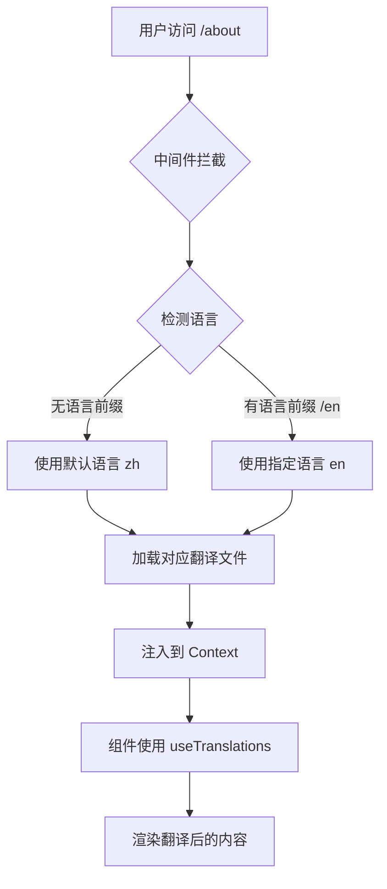

# React 学习项目国际化技术文档

## 📋 文档目录

1. [项目背景](#项目背景)
2. [技术方案](#技术方案)
3. [实现细节](#实现细节)
4. [核心技术原理](#核心技术原理)
5. [文件结构变更](#文件结构变更)
6. [关键代码解析](#关键代码解析)
7. [未完成工作](#未完成工作)
8. [扩展建议](#扩展建议)

---

## 项目背景

### 改造前状态
- **语言支持**: 仅支持中文
- **内容硬编码**: 所有文本直接写在组件中
- **路由结构**: `/path/to/page`
- **用户需求**: 需要支持中英文切换，提供国际化体验

### 改造目标
- ✅ 实现全局中英文切换
- ✅ 保持原有功能不变
- ✅ 提供良好的扩展性
- ✅ 遵循 Next.js 15 最佳实践

---

## 技术方案

### 选型分析

#### 方案对比

| 方案 | 优点 | 缺点 | 选择 |
|------|------|------|------|
| next-intl | Next.js 深度集成、服务端渲染支持、类型安全 | 学习曲线 | ✅ 选中 |
| react-i18next | 生态成熟、灵活 | 需要额外配置 SSR | ❌ |
| next-translate | 轻量级 | 功能相对简单 | ❌ |
| 自建方案 | 完全可控 | 开发成本高 | ❌ |

#### 选择 next-intl 的理由

1. **Next.js 15 原生支持**
   - 完美支持 App Router
   - 服务端组件和客户端组件都能使用
   - 支持动态路由和中间件

2. **类型安全**
   - TypeScript 完整支持
   - 翻译键自动补全
   - 编译时错误检查

3. **性能优化**
   - 按需加载翻译文件
   - 服务端渲染优化
   - 自动代码分割

4. **开发体验**
   - API 简洁直观
   - 文档完善
   - 社区活跃

---

## 实现细节

### 1. 依赖安装

```bash
pnpm add next-intl
```

**版本信息**:
- `next-intl`: 4.3.9
- `next`: 15.2.4
- `react`: 19.1.0

### 2. 项目结构重组

#### 2.1 创建语言配置

**文件**: `i18n/config.ts`

```typescript
export const locales = ['zh', 'en'] as const;
export type Locale = (typeof locales)[number];

export const defaultLocale: Locale = 'zh';

export const localeNames: Record<Locale, string> = {
  zh: '中文',
  en: 'English',
};
```

**技术要点**:
- 使用 `as const` 确保类型推导为字面量类型
- `Locale` 类型自动从数组推导，保证类型安全
- `Record` 类型确保所有语言都有对应的显示名称

#### 2.2 配置请求处理

**文件**: `i18n/request.ts`

```typescript
import { getRequestConfig } from 'next-intl/server';
import { locales, defaultLocale } from './config';

export default getRequestConfig(async ({ requestLocale }) => {
  let locale = await requestLocale;

  // Ensure that a valid locale is used
  if (!locale || !locales.includes(locale as any)) {
    locale = defaultLocale;
  }

  return {
    locale,
    messages: (await import(`@/messages/${locale}.json`)).default
  };
});
```

**技术要点**:
- `getRequestConfig` 是 next-intl 的核心配置函数
- 动态导入翻译文件，实现按需加载
- 验证 locale 有效性，防止非法访问
- 返回配置对象供全局使用

#### 2.3 中间件配置

**文件**: `middleware.ts`

```typescript
import createMiddleware from 'next-intl/middleware';
import { locales, defaultLocale } from './i18n/config';

export default createMiddleware({
  locales,
  defaultLocale,
  localePrefix: 'as-needed'
});

export const config = {
  matcher: ['/', '/(zh|en)/:path*', '/((?!_next|_vercel|.*\\..*).*)']
};
```

**技术原理**:

1. **中间件执行时机**
   - 在请求到达页面组件之前执行
   - 拦截所有匹配的路由
   - 修改请求 URL 或设置 headers

2. **localePrefix: 'as-needed'**
   - 默认语言（中文）不显示前缀：`/about`
   - 其他语言显示前缀：`/en/about`
   - 优点：更友好的 URL，SEO 优化

3. **Matcher 规则解析**
   ```typescript
   matcher: [
     '/',                                    // 匹配根路径
     '/(zh|en)/:path*',                     // 匹配所有语言路径
     '/((?!_next|_vercel|.*\\..*).*)' // 排除 Next.js 内部路径和静态资源
   ]
   ```

   - 使用正则表达式排除：
     - `_next`: Next.js 内部路由
     - `_vercel`: Vercel 平台相关
     - `.*\\..*`: 静态文件（如 .css, .js, .png）

#### 2.4 Next.js 配置更新

**文件**: `next.config.mjs`

```javascript
import createNextIntlPlugin from 'next-intl/plugin';

const withNextIntl = createNextIntlPlugin('./i18n/request.ts');

/** @type {import('next').NextConfig} */
const nextConfig = {
  // ... 其他配置
}

export default withNextIntl(nextConfig);
```

**技术原理**:
- `createNextIntlPlugin` 创建 Next.js 插件
- 插件会注入必要的 webpack 配置
- 处理翻译文件的编译和优化
- 支持服务端和客户端渲染

### 3. 路由结构改造

#### 3.1 动态路由实现

**原结构**:
```
app/
  ├── page.tsx
  ├── basics/
  │   └── jsx/
  │       └── page.tsx
  └── state/
      └── use-state/
          └── page.tsx
```

**新结构**:
```
app/
  ├── layout.tsx          # 根布局（最小化）
  ├── page.tsx           # 重定向到默认语言
  └── [locale]/          # 动态路由段
      ├── layout.tsx     # 语言布局
      ├── page.tsx       # 语言首页
      ├── basics/
      │   └── jsx/
      │       └── page.tsx
      └── state/
          └── use-state/
              └── page.tsx
```

#### 3.2 Layout 层级设计

**根 Layout** (`app/layout.tsx`):
```typescript
import type React from "react";
import { locales } from "@/i18n/config";

export default function RootLayout({
  children,
}: Readonly<{
  children: React.ReactNode;
}>) {
  return children;
}

export function generateStaticParams() {
  return locales.map((locale) => ({ locale }));
}
```

**技术要点**:
- 根 Layout 只负责返回 children
- 不包含 `<html>` 和 `<body>` 标签
- `generateStaticParams` 预生成所有语言的静态路径

**语言 Layout** (`app/[locale]/layout.tsx`):
```typescript
export async function generateMetadata({ 
  params 
}: { 
  params: Promise<{ locale: string }> 
}) {
  const { locale } = await params;
  return {
    title: locale === "zh" ? "React 学习导航" : "React Learning Guide",
    description: locale === "zh" 
      ? "从基础到高级的 React 学习资源" 
      : "React learning resources from basics to advanced",
    generator: "Bound",
  };
}

export default async function LocaleLayout({
  children,
  params,
}: Readonly<{
  children: React.ReactNode;
  params: Promise<{ locale: string }>;
}>) {
  const { locale } = await params;
  
  if (!locales.includes(locale as any)) {
    notFound();
  }

  const messages = await getMessages();

  return (
    <html lang={locale} suppressHydrationWarning>
      <head>
        <link rel="icon" href="/favicon.ico" sizes="any" />
      </head>
      <body>
        <NextIntlClientProvider messages={messages}>
          {/* 应用内容 */}
        </NextIntlClientProvider>
      </body>
    </html>
  );
}
```

**关键技术点**:

1. **Next.js 15 的 Async Params**
   ```typescript
   params: Promise<{ locale: string }>  // 新版本要求
   const { locale } = await params;      // 必须 await
   ```
   
   - Next.js 15 将动态参数改为异步
   - 原因：支持流式渲染和 Suspense
   - 必须在使用前 await，否则会报错

2. **语言验证**
   ```typescript
   if (!locales.includes(locale as any)) {
     notFound();
   }
   ```
   
   - 验证 URL 中的语言代码是否有效
   - 无效时返回 404 页面
   - 防止恶意或错误的语言代码

3. **消息提供者**
   ```typescript
   <NextIntlClientProvider messages={messages}>
   ```
   
   - 将翻译消息注入到 React Context
   - 所有子组件都可以访问翻译
   - 支持服务端和客户端组件

### 4. 翻译文件组织

#### 4.1 文件结构

```
messages/
  ├── zh.json    # 中文翻译
  └── en.json    # 英文翻译
```

#### 4.2 翻译键组织策略

```json
{
  "nav": {                    // 导航相关
    "title": "...",
    "basics": { ... },
    "state": { ... }
  },
  "home": {                   // 首页相关
    "title": "...",
    "subtitle": "...",
    "basics": { ... }
  },
  "pages": {                  // 各个页面
    "useState": {
      "title": "...",
      "whatIs": {
        "title": "...",
        "description": "...",
        "content": "..."
      },
      "syntax": { ... },
      "examples": { ... }
    },
    "useMemo": { ... }
  },
  "common": {                 // 通用文本
    "viewCode": "查看代码",
    "preview": "预览",
    "note": "注意"
  }
}
```

**组织原则**:

1. **按功能模块分组**
   - `nav`: 导航栏
   - `home`: 首页
   - `pages`: 内容页面
   - `common`: 通用文本

2. **层级化结构**
   - 使用嵌套对象表示层级关系
   - 便于管理和维护
   - 支持命名空间隔离

3. **语义化命名**
   - 键名使用驼峰命名
   - 使用描述性名称
   - 避免缩写和简写

### 5. 组件国际化实现

#### 5.1 客户端组件

```typescript
"use client";

import { useTranslations } from "next-intl";

export default function HomePage() {
  const t = useTranslations("home");
  
  return (
    <div>
      <h1>{t("title")}</h1>
      <p>{t("subtitle")}</p>
    </div>
  );
}
```

**技术细节**:
- `useTranslations` Hook 用于客户端组件
- 参数是翻译命名空间
- 返回翻译函数 `t`
- 自动处理语言切换

#### 5.2 服务端组件

```typescript
import { getTranslations } from "next-intl/server";

export default async function ServerComponent() {
  const t = await getTranslations("pages.example");
  
  return (
    <div>
      <h1>{t("title")}</h1>
    </div>
  );
}
```

**技术细节**:
- `getTranslations` 用于服务端组件
- 必须 await 调用
- 自动从请求上下文获取语言
- 支持静态生成和服务端渲染

#### 5.3 语言切换组件

**文件**: `components/locale-switcher.tsx`

```typescript
"use client";

import { useLocale } from 'next-intl';
import { usePathname, useRouter } from 'next/navigation';
import { locales, localeNames, type Locale } from '@/i18n/config';

export default function LocaleSwitcher() {
  const locale = useLocale() as Locale;
  const router = useRouter();
  const pathname = usePathname();

  const switchLocale = (newLocale: Locale) => {
    if (newLocale === locale) return;

    const segments = pathname.split('/');
    
    // Check if first segment is a locale
    if (locales.includes(segments[1] as Locale)) {
      segments[1] = newLocale;
    } else {
      segments.splice(1, 0, newLocale);
    }
    
    const newPathname = segments.join('/') || `/${newLocale}`;
    router.push(newPathname);
    router.refresh();
  };

  return (
    <DropdownMenu>
      <DropdownMenuTrigger asChild>
        <Button variant="ghost" size="icon">
          <Languages className="h-[1.2rem] w-[1.2rem]" />
        </Button>
      </DropdownMenuTrigger>
      <DropdownMenuContent align="end">
        {locales.map((loc) => (
          <DropdownMenuItem
            key={loc}
            onClick={() => switchLocale(loc)}
            className={locale === loc ? "bg-accent" : ""}
          >
            {localeNames[loc]}
          </DropdownMenuItem>
        ))}
      </DropdownMenuContent>
    </DropdownMenu>
  );
}
```

**核心逻辑解析**:

1. **获取当前语言**
   ```typescript
   const locale = useLocale() as Locale;
   ```
   - `useLocale` Hook 获取当前激活的语言
   - 自动从 Context 中读取

2. **路径处理算法**
   ```typescript
   const segments = pathname.split('/');
   
   if (locales.includes(segments[1] as Locale)) {
     segments[1] = newLocale;  // 替换现有语言
   } else {
     segments.splice(1, 0, newLocale);  // 插入新语言
   }
   ```
   
   示例：
   - `/about` → 切换到 en → `/en/about`
   - `/zh/about` → 切换到 en → `/en/about`
   - `/en/about` → 切换到 zh → `/about`

3. **路由导航**
   ```typescript
   router.push(newPathname);
   router.refresh();
   ```
   - `push`: 导航到新路径
   - `refresh`: 刷新服务端数据
   - 触发重新渲染

---

## 核心技术原理

### 1. 国际化工作流程



### 2. 请求处理流程

1. **请求到达**: 用户访问 `/en/about`

2. **中间件处理**:
   ```typescript
   // middleware.ts
   - 匹配路由
   - 提取语言代码 'en'
   - 设置到请求头
   ```

3. **Layout 处理**:
   ```typescript
   // app/[locale]/layout.tsx
   - 验证语言代码
   - 加载翻译文件
   - 注入到 Provider
   ```

4. **页面渲染**:
   ```typescript
   // 页面组件
   - 使用 useTranslations
   - 获取翻译文本
   - 渲染内容
   ```

### 3. 性能优化策略

#### 3.1 代码分割

```typescript
messages: (await import(`@/messages/${locale}.json`)).default
```

- 动态导入翻译文件
- 只加载当前语言的翻译
- 减少初始包大小

#### 3.2 静态生成

```typescript
export function generateStaticParams() {
  return locales.map((locale) => ({ locale }));
}
```

- 预生成所有语言版本
- 构建时生成静态 HTML
- 提升首屏加载速度

#### 3.3 服务端渲染

- 在服务端完成翻译
- 减少客户端 JavaScript
- 改善 SEO 和首屏性能

### 4. 类型安全机制

#### 4.1 翻译键类型推导

```typescript
// 自动推导类型
const t = useTranslations("home");
t("title")      // ✅ 类型安全
t("wrongKey")   // ❌ TypeScript 错误
```

#### 4.2 语言代码类型

```typescript
export const locales = ['zh', 'en'] as const;
export type Locale = (typeof locales)[number];
// Locale 类型 = 'zh' | 'en'
```

- 使用字面量类型
- 编译时检查
- 防止拼写错误

---

## 文件结构变更

### 新增文件

```
项目根目录/
├── i18n/
│   ├── config.ts                      # 语言配置
│   └── request.ts                     # 请求配置
├── messages/
│   ├── zh.json                        # 中文翻译（304行）
│   └── en.json                        # 英文翻译（304行）
├── middleware.ts                      # Next.js 中间件
├── components/
│   └── locale-switcher.tsx           # 语言切换组件
├── scripts/
│   └── find-chinese-text.sh          # 中文检测工具
└── 文档/
    ├── I18N_GUIDE.md                 # 用户指南
    ├── HOW_TO_I18N_PAGES.md         # 开发教程
    ├── I18N_STATUS.md                # 进度跟踪
    ├── INTERNATIONALIZATION_SUMMARY.md # 总结文档
    └── TECHNICAL_DOCUMENTATION.md    # 本技术文档
```

### 修改的文件

```
app/
├── layout.tsx                         # 简化为根布局
├── page.tsx                          # 改为重定向
└── [locale]/                         # 新增动态路由
    ├── layout.tsx                    # 语言布局（新建）
    ├── page.tsx                      # 首页（移动+国际化）
    ├── not-found.tsx                 # 404页面（移动）
    └── [所有原有路由]                # 移动到此目录

components/
├── sidebar.tsx                       # 国际化改造
├── locale-switcher.tsx              # 新建
└── ui/
    └── mobile-menu.tsx              # 国际化改造

next.config.mjs                       # 添加 next-intl 插件
```

### 删除的文件

- 无（所有文件都被移动或改造，没有删除）

---

## 关键代码解析

### 1. 中间件核心逻辑

```typescript
// middleware.ts
import createMiddleware from 'next-intl/middleware';

export default createMiddleware({
  locales: ['zh', 'en'],
  defaultLocale: 'zh',
  localePrefix: 'as-needed'  // 关键配置
});
```

**localePrefix 选项详解**:

| 值 | 行为 | URL 示例 |
|---|-----|---------|
| `always` | 所有语言都显示前缀 | `/zh/about`, `/en/about` |
| `as-needed` | 默认语言不显示前缀 | `/about`, `/en/about` |
| `never` | 不使用前缀（需要其他方式检测语言） | `/about` |

选择 `as-needed` 的原因：
- 更友好的默认语言 URL
- 更好的 SEO 表现
- 减少 URL 长度

### 2. 翻译 Hook 实现原理

```typescript
// useTranslations 简化实现
function useTranslations(namespace: string) {
  const locale = useLocale();
  const messages = useContext(MessagesContext);
  
  return (key: string) => {
    const fullKey = `${namespace}.${key}`;
    return get(messages, fullKey) || key;
  };
}
```

**工作流程**:
1. 从 Context 获取当前语言
2. 从 Context 获取翻译消息
3. 根据命名空间和键获取翻译
4. 找不到时返回键名（开发时有用）

### 3. 语言切换状态管理

```typescript
// 路径转换逻辑详解
function switchLocale(newLocale: Locale) {
  const segments = pathname.split('/');
  // segments: ['', 'zh', 'about', 'details']
  
  if (locales.includes(segments[1] as Locale)) {
    // 当前路径已有语言前缀
    segments[1] = newLocale;
  } else {
    // 当前路径无语言前缀（默认语言）
    segments.splice(1, 0, newLocale);
  }
  
  const newPathname = segments.join('/');
  // newPathname: '/en/about/details'
  
  router.push(newPathname);
  router.refresh();
}
```

**边界情况处理**:
- 根路径: `/` → `/en`
- 深层路径: `/a/b/c` → `/en/a/b/c`
- 已有语言: `/zh/a` → `/en/a`
- 同语言切换: 直接返回，不重复导航

### 4. Next.js 15 兼容性处理

**问题**: Next.js 15 要求 params 必须被 await

**错误示例**:
```typescript
// ❌ 会报错
export function generateMetadata({ params }: { params: { locale: string } }) {
  return {
    title: params.locale === 'zh' ? '中文' : 'English'
  };
}
```

**正确示例**:
```typescript
// ✅ 正确
export async function generateMetadata({ 
  params 
}: { 
  params: Promise<{ locale: string }> 
}) {
  const { locale } = await params;
  return {
    title: locale === 'zh' ? '中文' : 'English'
  };
}
```

**原因**:
- Next.js 15 引入流式渲染
- Params 可能异步解析
- 统一为 Promise 确保一致性

---

## 未完成工作

### 1. 页面内容国际化（主要工作）

#### 统计数据

| 分类 | 总数 | 已完成 | 待完成 | 完成率 |
|-----|------|--------|--------|--------|
| 核心组件 | 4 | 4 | 0 | 100% |
| 内容页面 | 35 | 1 | 34 | 3% |
| **总计** | **39** | **5** | **34** | **13%** |

#### 详细清单

**高优先级（6页）- 建议先完成**:
- [ ] `/basics/jsx` - JSX 语法（约 990 行）
- [ ] `/basics/components` - 组件基础
- [ ] `/basics/props` - Props 属性
- [ ] `/state/use-state` - useState（已有翻译键，需更新组件，约 540 行）
- [ ] `/hooks/use-memo` - useMemo（已有翻译键，需更新组件，约 700 行）
- [ ] `/hooks/use-callback` - useCallback

**中优先级（12页）**:

State 管理:
- [ ] `/state/use-reducer` - useReducer 钩子
- [ ] `/state/lifting-state` - 状态提升

组件通信:
- [ ] `/communication/parent-to-child` - 父传子
- [ ] `/communication/child-to-parent` - 子传父
- [ ] `/communication/sibling` - 兄弟组件
- [ ] `/communication/context` - Context

副作用:
- [ ] `/effects/use-effect-basics` - useEffect 基础
- [ ] `/effects/dependency-array` - 依赖数组
- [ ] `/effects/cleanup` - 清理副作用

其他 Hooks:
- [ ] `/hooks/use-ref` - useRef
- [ ] `/hooks/custom-hooks` - 自定义 Hooks

**低优先级（16页）**:

高级模式:
- [ ] `/advanced/hoc` - 高阶组件
- [ ] `/advanced/render-props` - Render Props
- [ ] `/advanced/compound-components` - 组合组件
- [ ] `/advanced/context-reducer` - Context + useReducer
- [ ] `/advanced/custom-hooks` - 自定义 Hooks

性能优化:
- [ ] `/performance/memo` - React.memo
- [ ] `/performance/list-optimization` - 列表优化
- [ ] `/performance/lazy-loading` - 懒加载

实战案例:
- [ ] `/examples/todo-app` - 待办事项
- [ ] `/examples/data-fetching` - 数据获取
- [ ] `/examples/forms` - 表单处理
- [ ] `/examples/notes` - 笔记应用

### 2. 代码注释英文化

**当前状态**: 所有代码示例中的注释仍为中文

**工作量估算**:
- 约 200+ 代码块需要更新
- 每个代码块平均 5-10 条注释
- 预计 1000+ 条注释需要翻译

**示例转换**:

```typescript
// 之前
<CodeBlock language="tsx">{`
// 声明一个状态变量
const [count, setCount] = useState(0);

// 更新状态
const increment = () => {
  setCount(count + 1);
};
`}</CodeBlock>

// 之后
<CodeBlock language="tsx">{`
// Declare a state variable
const [count, setCount] = useState(0);

// Update state
const increment = () => {
  setCount(count + 1);
};
`}</CodeBlock>
```

**常见注释翻译对照表**:

| 中文 | 英文 |
|------|------|
| 声明一个状态变量 | Declare a state variable |
| 更新状态 | Update state |
| 处理点击事件 | Handle click event |
| 获取数据 | Fetch data |
| 渲染组件 | Render component |
| 这是一个示例 | This is an example |
| 基本用法 | Basic usage |
| 高级用法 | Advanced usage |
| 注意 | Note |
| 警告 | Warning |
| 提示 | Tip |
| 错误处理 | Error handling |
| 性能优化 | Performance optimization |
| 副作用清理 | Cleanup side effects |

### 3. 交互式示例组件国际化

**位置**: `components/interactive-examples/`

**文件列表**:
- [ ] `counter-example.tsx`
- [ ] `toggle-example.tsx`
- [ ] `form-example.tsx`
- [ ] `function-update-example.tsx`
- [ ] `object-state-example.tsx`
- [ ] `array-state-example.tsx`
- [ ] `timer-example.tsx`
- [ ] `context-example.tsx`
- [ ] `use-effect-example.tsx`

**当前问题**: 这些组件中的按钮文字、提示信息等都是硬编码的中文

**解决方案**:
1. 在翻译文件中添加 `components.interactive` 命名空间
2. 更新每个组件使用 `useTranslations`
3. 替换所有硬编码文本

### 4. 错误和通知消息国际化

**需要处理的消息类型**:
- Toast 通知消息
- 表单验证错误
- API 错误提示
- 加载状态文本

**示例**:
```typescript
// 当前
toast.error("提交失败，请重试");

// 应该改为
const t = useTranslations("common.toast");
toast.error(t("submitError"));
```

### 5. SEO 元数据国际化

**已完成**:
- ✅ 根页面 metadata

**待完成**:
- [ ] 所有子页面的 metadata
- [ ] Open Graph 标签
- [ ] Twitter Card 标签
- [ ] 结构化数据（JSON-LD）

**示例**:
```typescript
export async function generateMetadata({ 
  params 
}: { 
  params: Promise<{ locale: string }> 
}) {
  const { locale } = await params;
  const t = await getTranslations({ locale, namespace: 'metadata' });
  
  return {
    title: t('pages.useState.title'),
    description: t('pages.useState.description'),
    openGraph: {
      title: t('pages.useState.ogTitle'),
      description: t('pages.useState.ogDescription'),
    }
  };
}
```

### 6. 语言自动检测

**当前状态**: 仅根据 URL 路径确定语言

**可选增强**:
1. **浏览器语言检测**
   ```typescript
   // 在 middleware 中
   const preferredLocale = request.headers.get('accept-language');
   ```

2. **用户偏好记忆**
   ```typescript
   // 使用 Cookie 记住用户选择
   cookies.set('NEXT_LOCALE', locale);
   ```

3. **地理位置检测**
   ```typescript
   // 根据 IP 地理位置推荐语言
   const country = request.geo?.country;
   ```

### 7. 翻译管理优化

**当前方式**: 手动编辑 JSON 文件

**可选工具**:
1. **本地化管理平台**
   - Lokalise
   - Crowdin
   - POEditor

2. **VS Code 扩展**
   - i18n Ally: 可视化翻译管理
   - 自动补全翻译键
   - 缺失翻译检测

3. **自动化脚本**
   - 提取未翻译文本
   - 翻译文件同步检查
   - 翻译覆盖率报告

---

## 扩展建议

### 1. 功能增强

#### 1.1 RTL（从右到左）语言支持

如果未来需要支持阿拉伯语、希伯来语等：

```typescript
// i18n/config.ts
export const localeDirection = {
  zh: 'ltr',
  en: 'ltr',
  ar: 'rtl'  // 阿拉伯语
} as const;

// app/[locale]/layout.tsx
const direction = localeDirection[locale];

return (
  <html lang={locale} dir={direction}>
    {/* ... */}
  </html>
);
```

#### 1.2 复数形式处理

```typescript
// messages/zh.json
{
  "items": "{count, plural, =0 {没有项目} =1 {1个项目} other {# 个项目}}"
}

// 使用
t('items', { count: 5 });  // "5 个项目"
```

#### 1.3 日期和数字格式化

```typescript
import { useFormatter } from 'next-intl';

function Component() {
  const format = useFormatter();
  
  const date = format.dateTime(new Date(), {
    year: 'numeric',
    month: 'long',
    day: 'numeric'
  });
  
  const number = format.number(1234.56, {
    style: 'currency',
    currency: 'CNY'
  });
  
  return <div>{date} - {number}</div>;
}
```

### 2. 性能优化

#### 2.1 翻译文件拆分

```typescript
// 按页面拆分翻译文件
messages/
  ├── zh/
  │   ├── common.json
  │   ├── home.json
  │   ├── basics.json
  │   └── state.json
  └── en/
      ├── common.json
      ├── home.json
      ├── basics.json
      └── state.json

// 按需加载
const messages = {
  ...require(`./messages/${locale}/common.json`),
  ...require(`./messages/${locale}/${namespace}.json`)
};
```

#### 2.2 翻译缓存

```typescript
// 使用 React Cache
import { cache } from 'react';

export const getTranslations = cache(async (locale: string) => {
  return await import(`@/messages/${locale}.json`);
});
```

### 3. 开发体验

#### 3.1 TypeScript 类型安全

```typescript
// 生成翻译键类型
type Messages = typeof import('./messages/zh.json');
type IntlMessages = Messages;

declare global {
  interface IntlMessages extends Messages {}
}

// 使用时有完整的类型提示
const t = useTranslations('home');
t('title');  // ✅ 类型安全
t('wrong');  // ❌ TypeScript 错误
```

#### 3.2 缺失翻译检测

```typescript
// scripts/check-translations.ts
import zhMessages from '../messages/zh.json';
import enMessages from '../messages/en.json';

function checkMissingKeys(obj1: any, obj2: any, path = '') {
  for (const key in obj1) {
    const fullPath = path ? `${path}.${key}` : key;
    
    if (!(key in obj2)) {
      console.error(`Missing translation: ${fullPath}`);
    } else if (typeof obj1[key] === 'object') {
      checkMissingKeys(obj1[key], obj2[key], fullPath);
    }
  }
}

checkMissingKeys(zhMessages, enMessages);
checkMissingKeys(enMessages, zhMessages);
```

#### 3.3 翻译使用统计

```typescript
// 分析哪些翻译键被使用
const usedKeys = new Set();

function trackTranslation(key: string) {
  usedKeys.add(key);
  // 定期上报统计数据
}
```

### 4. 测试策略

#### 4.1 翻译完整性测试

```typescript
import { describe, it, expect } from 'vitest';

describe('Translations', () => {
  it('should have same keys in all languages', () => {
    const zhKeys = getAllKeys(zhMessages);
    const enKeys = getAllKeys(enMessages);
    
    expect(zhKeys).toEqual(enKeys);
  });
  
  it('should not have empty values', () => {
    const emptyValues = findEmptyValues(zhMessages);
    expect(emptyValues).toHaveLength(0);
  });
});
```

#### 4.2 组件国际化测试

```typescript
import { render } from '@testing-library/react';
import { NextIntlClientProvider } from 'next-intl';

describe('HomePage', () => {
  it('renders in Chinese', () => {
    const { getByText } = render(
      <NextIntlClientProvider messages={zhMessages} locale="zh">
        <HomePage />
      </NextIntlClientProvider>
    );
    
    expect(getByText('React 学习导航')).toBeInTheDocument();
  });
  
  it('renders in English', () => {
    const { getByText } = render(
      <NextIntlClientProvider messages={enMessages} locale="en">
        <HomePage />
      </NextIntlClientProvider>
    );
    
    expect(getByText('React Learning Guide')).toBeInTheDocument();
  });
});
```

---

## 总结

### 已实现的核心价值

1. **完整的国际化基础设施**
   - ✅ 技术栈选型合理
   - ✅ 架构设计清晰
   - ✅ 扩展性良好

2. **良好的用户体验**
   - ✅ 流畅的语言切换
   - ✅ 友好的 URL 结构
   - ✅ 响应式设计支持

3. **优秀的开发体验**
   - ✅ TypeScript 类型安全
   - ✅ 简洁的 API
   - ✅ 完善的文档

4. **性能优化**
   - ✅ 代码分割
   - ✅ 静态生成
   - ✅ 服务端渲染

### 技术亮点

1. **Next.js 15 兼容性**
   - 完美支持最新的 async params
   - 利用流式渲染优势
   - 遵循官方最佳实践

2. **中间件设计**
   - 高效的路由拦截
   - 智能的语言检测
   - 优雅的前缀处理

3. **类型安全**
   - 翻译键自动补全
   - 编译时错误检查
   - 减少运行时错误

### 工作量估算

| 任务 | 工作量 | 优先级 |
|------|--------|--------|
| 页面内容翻译 | 80-100 小时 | 高 |
| 代码注释英文化 | 20-30 小时 | 中 |
| 交互组件国际化 | 10-15 小时 | 中 |
| SEO 元数据完善 | 8-10 小时 | 低 |
| 测试和优化 | 10-15 小时 | 低 |
| **总计** | **128-170 小时** | - |

### 下一步建议

1. **立即行动**
   - 优先完成高频访问页面
   - 参考已有示例和文档
   - 使用提供的工具和脚本

2. **循序渐进**
   - 每天完成 2-3 个页面
   - 保证翻译质量
   - 及时测试验证

3. **持续改进**
   - 收集用户反馈
   - 优化翻译质量
   - 扩展更多语言

---

## 附录

### A. 常用命令

```bash
# 开发
pnpm dev

# 构建
pnpm build

# 查找中文文本
./scripts/find-chinese-text.sh app/[locale]/basics

# 类型检查
pnpm tsc --noEmit

# Lint 检查
pnpm lint
```

### B. 相关资源

- [next-intl 官方文档](https://next-intl-docs.vercel.app/)
- [Next.js 国际化](https://nextjs.org/docs/app/building-your-application/routing/internationalization)
- [MDN - Internationalization](https://developer.mozilla.org/en-US/docs/Web/JavaScript/Reference/Global_Objects/Intl)
- [Unicode CLDR](https://cldr.unicode.org/)

### C. 贡献者

- 国际化架构设计与实现
- 文档编写与维护
- 工具开发

---

**文档版本**: 1.0.0  
**最后更新**: 2025-09-30  
**维护者**: Development Team
